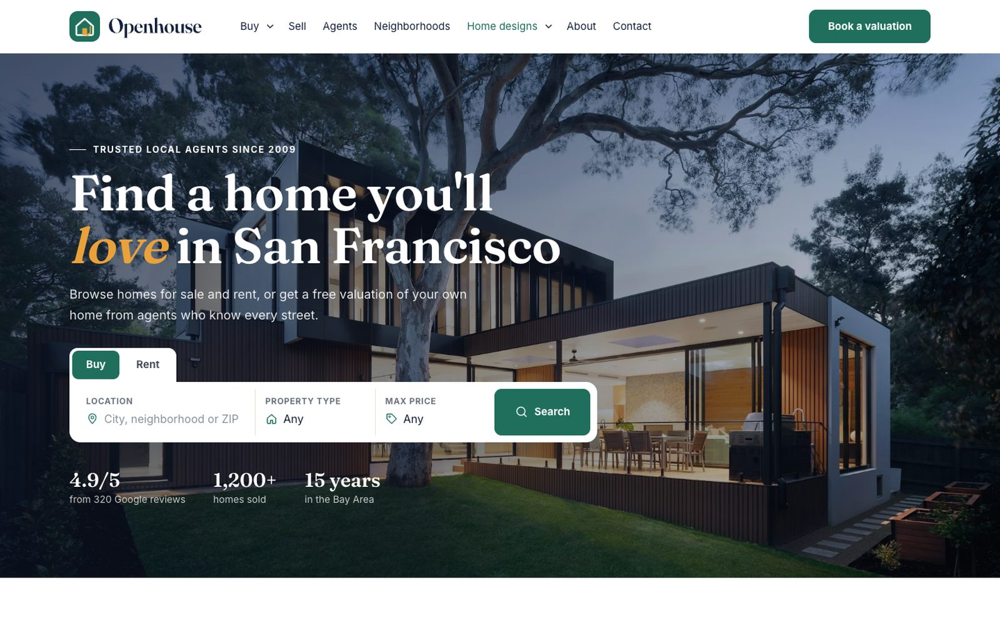
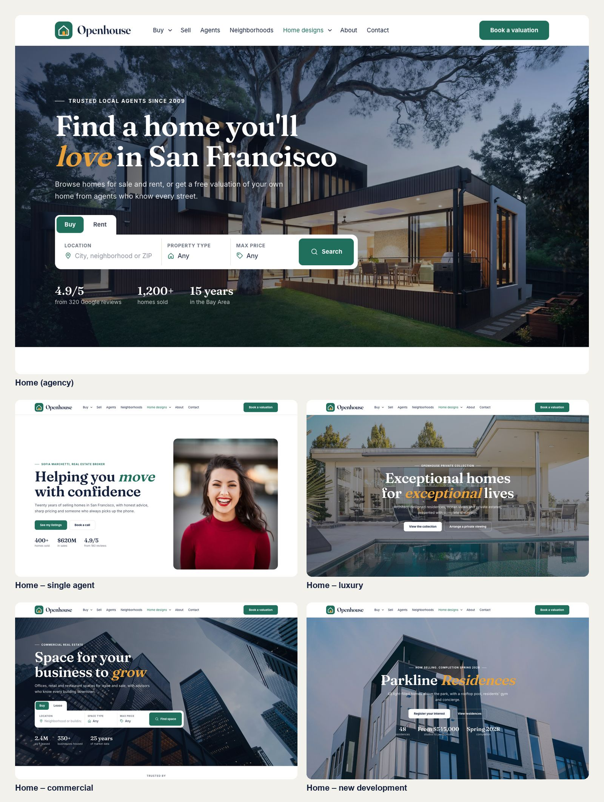
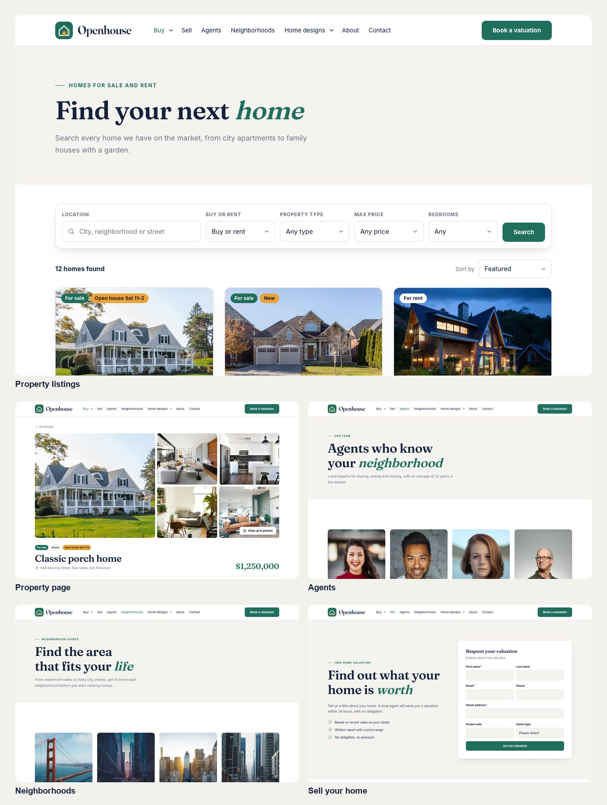

# Welcome to Openhouse

Openhouse is a HubSpot CMS theme for real estate agents and agencies. It turns your listings, agents and neighborhoods into a clean, light website, and sends every inquiry and valuation request straight into your HubSpot CRM.

**Live demo:** [assets.pixtheme.com/openhouse-demo](https://assets.pixtheme.com/openhouse-demo)

## What's included

| | |
|---|---|
| **Home pages** | 5 designs: agency, single agent, luxury, commercial and new development |
| **Property pages** | Listings with search, filters and sorting, and a page for every property with gallery, floor plan, video, map, mortgage calculator and inquiry form |
| **Team and areas** | Agents list with profile pages, neighborhoods list with area guides |
| **Company pages** | Sell your home (valuation request), About, Contact |
| **Blog** | Blog listing and blog post templates |
| **System pages** | 404, 500, password prompt, search results, email subscription pages and membership pages |
| **Modules** | 24 drag-and-drop modules plus the site header and footer |
| **Sections** | 12 ready-made sections you can drop into any page |

## Where to start

-   **[Install the theme](getting-started/install.md)**
-   **[Set up your listings (HubDB)](getting-started/hubdb.md)**
-   **[Build your site](getting-started/build-your-site.md)**
-   **[Forms and leads](getting-started/forms-and-leads.md)**

## Requirements

* A HubSpot account that can create website pages.
* **Property, agent and neighborhood pages from HubDB** (one page per row, created automatically) need **Content Hub Professional** or Enterprise.
* On **Content Hub Starter** you can still use every page: the Property Cards, Agent Cards and Neighborhood Tiles modules let you type the content in, and the Property Details module works on a normal page.
* Membership pages need a Content Hub plan that includes memberships.
* No coding is needed. Everything is edited in the page editor, theme settings and HubDB.

!!! note "No MLS or IDX feed"

    Openhouse doesn't connect to an MLS or IDX feed. You add properties in HubDB, which is a spreadsheet-like table in HubSpot. If you'd like your listings synced from another system, [contact us](help/support.md) about a custom integration.
