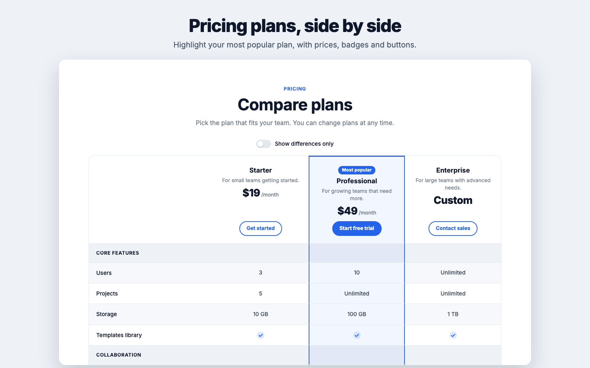
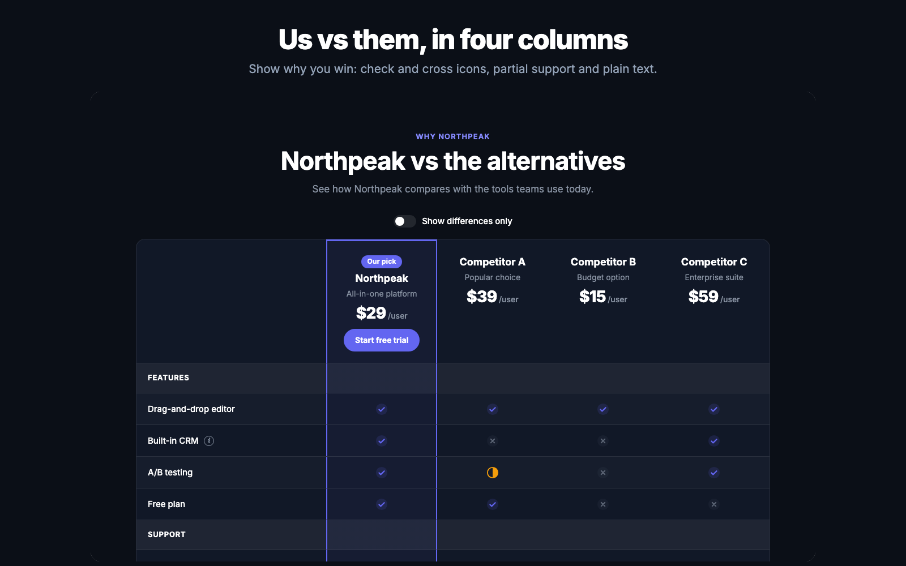
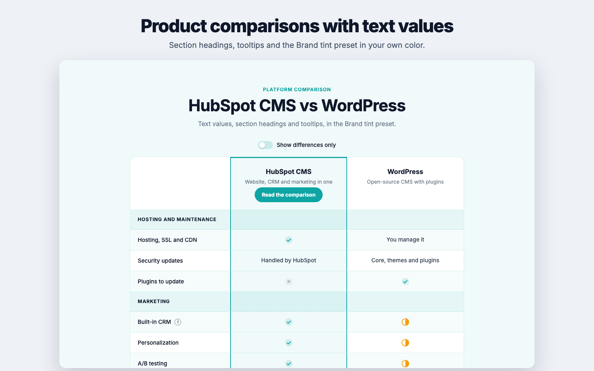

# Examples

All three examples are on the [live demo page](https://assets.pixtheme.com/modules/comparison-table-demo).

## Pricing plans

* 3 columns with prices, periods and buttons.
* **Highlight this column** and a *Most popular* badge on the plan you recommend.
* Section headings such as *Core features*, *Collaboration* and *Support and security*.
* **Light** preset, with **Repeat buttons below the table** turned on.

## Us vs competitors

* Your product in the first column, highlighted, with an *Our pick* badge and a button. Competitors without buttons.
* Mostly `yes`, `no` and `partial` values, so differences stand out.
* **Dark** preset and **One card per column** on phones.
* A footnote with the source and date of the comparison.

!!! tip "Keep competitor comparisons fair"
    Use public information, add the date in the footnote and update the table when competitors change their plans.

## Product or platform comparison

* 2 columns with text values such as *Handled by HubSpot* or *You manage it*.
* Tooltips to explain features that need context.
* **Brand tint** preset in your own color and a smaller **Maximum width**.
