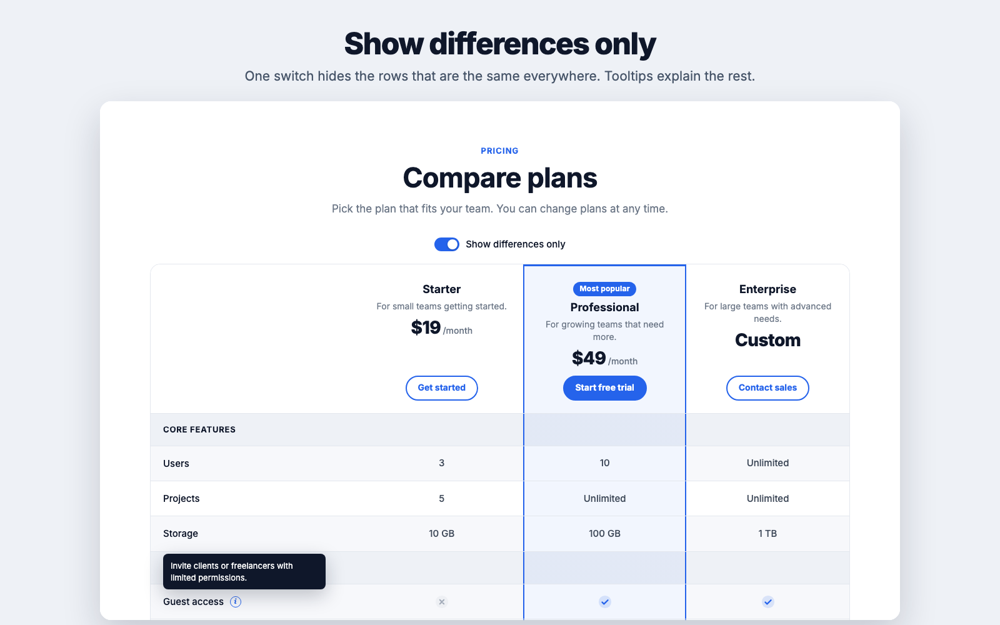
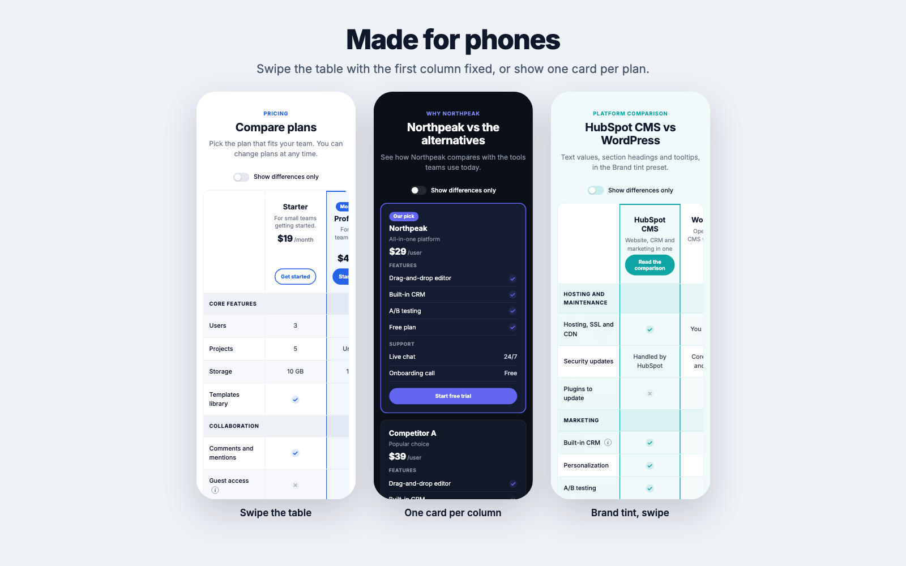

# Table options

Open **Table options** in the module's content settings.

## Show differences only

**Show the 'differences only' switch** adds a switch above the table. When visitors turn it on, rows that have the same value in every column are hidden, along with section headings that no longer have any rows. Change the switch's text in **Switch label**.

## Sticky bar with the column names

**Keep column names visible while scrolling** shows a slim bar with the column names and prices while visitors scroll through a long table on desktop. It appears after the column headings scroll out of view and hides near the end of the table.

The bar finds your site's fixed or sticky header and sits right below it. If your header has an unusual setup and the bar ends up underneath it, set **Sticky header offset** to your header's height in pixels. Leave it at **0** for automatic.

## Mobile layout

| Option | What visitors see on phones |
|---|---|
| **Swipe the table** | The full table. Visitors swipe sideways, and the feature names stay fixed on the left |
| **One card per column** | Each plan or product as its own card, with all its values listed |

Cards work well for 3 or more columns with short feature names. Swiping works well when visitors need to compare columns directly.

## Buttons and footnote

* **Repeat buttons below the table:** shows each column's button again at the bottom, so visitors don't have to scroll back up.
* **Footnote:** small text below the table, for example tax, trial or data source details.

## Labels and translations

**Labels and translations** holds text that screen readers announce: the meaning of the icons (*Included*, *Not included*, *Partly included*, *Not applicable*) and the info button. Translate these for pages in other languages. The **First column heading** in Table options is also read by screen readers, even when it's hidden.
