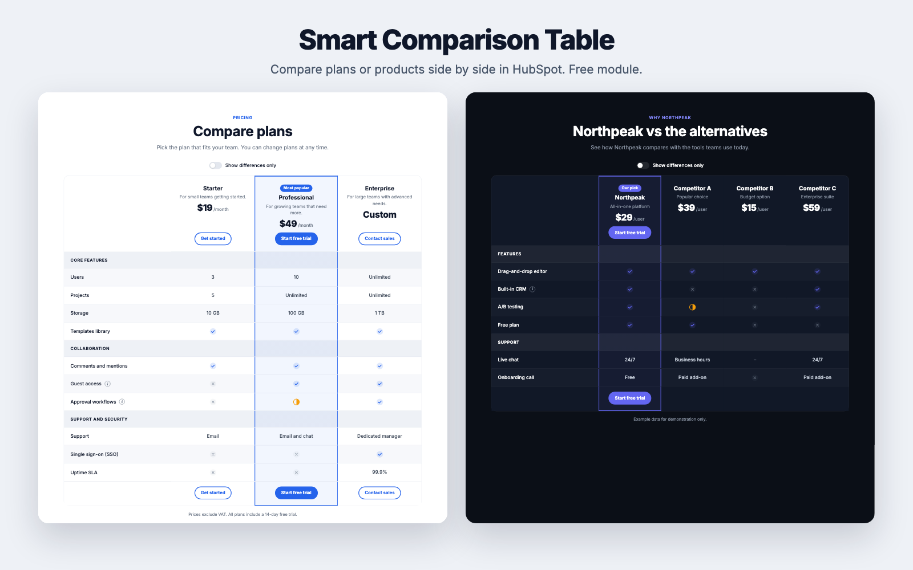

# Welcome to Smart Comparison Table

Smart Comparison Table is a free HubSpot module for comparing pricing plans or products side by side. You fill in simple fields in the page editor, and visitors get a clear table with check and cross icons, tooltips, a "show differences only" switch and layouts made for phones.

**Live demo:** [assets.pixtheme.com/modules/comparison-table-demo](https://assets.pixtheme.com/modules/comparison-table-demo)

## What's included

| | |
|---|---|
| **Columns** | 2 to 6 plans or products, each with a name, description, price, badge, optional logo and button |
| **Rows** | Up to 80 feature rows and section headings, with optional tooltips |
| **Values** | `yes`, `no` and `partial` become icons. Any other text, such as `10 GB`, shows as text |
| **For visitors** | "Show differences only" switch, a slim sticky bar with the column names on desktop, tooltips |
| **On phones** | Swipe the table with the feature names fixed, or show one card per column |
| **Style** | Light, Dark and Brand tint presets, your brand color, custom colors, row height, stripes, corner radius |

## Where to start

-   **[Install the module](getting-started/install.md)**
-   **[Build your table](getting-started/build-your-table.md)**
-   **[Examples](customize/examples.md)**

## Requirements

* A HubSpot account that can create website pages or landing pages.
* Any HubSpot theme. The module uses your theme's primary color by default and looks the same in every theme.
* No coding is needed. Everything is edited in the HubSpot page editor.
